# BangDB Manager

**BangDB · PostgreSQL · MySQL/MariaDB · SQL Server · SQLite · MongoDB · Redis 를 한 앱에서 관리하는 크로스플랫폼 데이터베이스 관리 도구.**
테이블을 엑셀처럼 바로 고치고, SQL 을 실행하고, 구조를 바꾸고, 가져오기·내보내기·백업까지 — Windows · macOS · Linux · Android · 웹에서 같은 화면으로 씁니다.

> *A cross-platform database manager for BangDB, PostgreSQL, MySQL/MariaDB, SQL Server, SQLite, MongoDB and Redis — edit tables like a spreadsheet, run SQL, change schemas, import, export and back up, with the same app on Windows, macOS, Linux, Android and the web.* ([English summary](#english))

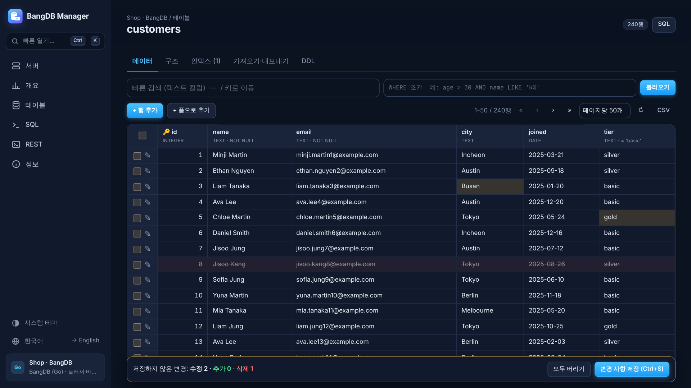

## 다운로드

**[최신 버전 받기 → Releases](https://github.com/MinaryHub/BangDB.Manager/releases/latest)** · 무료

| 플랫폼 | 파일 | 설치 |
|---|---|---|
| Windows 10/11 (x64) | `bangdb-manager-<버전>-windows-x64-setup.exe` | 실행 후 설치 위치 선택. 서명이 없어 SmartScreen 경고가 뜨면 "추가 정보 → 실행" · **자동 업데이트** |
| macOS (Apple Silicon) | `bangdb-manager-<버전>-macos-arm64.dmg` | 서명이 없어 처음엔 우클릭 → 열기 · 새 버전 알림 |
| Linux (x64) | `bangdb-manager-<버전>-linux-x86_64.AppImage` | `chmod +x` 후 실행 · **자동 업데이트** |
| Debian / Ubuntu | `bangdb-manager-<버전>-linux-amd64.deb` | `sudo apt install ./bangdb-manager-*.deb` · 새 버전 알림 |
| Android | `bangdb-manager-<버전>-android-debug.apk` | APK 설치 허용 후 설치 · 새 버전 알림 |
| 웹 / 휴대폰 브라우저 | `bangdb-manager-web-<버전>.zip` 또는 데스크톱 앱의 "휴대폰 접속 허용" | 브라우저에서 열고 "홈 화면에 추가"(PWA) · 자동 업데이트 |

데스크톱 앱에는 DB 게이트웨이가 들어 있어 PostgreSQL·MySQL 등도 추가 설치 없이 바로 연결됩니다.

## 주요 기능

- **7가지 데이터베이스, 한 화면** — BangDB (Go)·BangDB 2.0 REST·PostgreSQL·MySQL/MariaDB·SQL Server·SQLite 는 같은 테이블/SQL 화면, MongoDB 는 컬렉션·문서·집계 화면, Redis 는 키 브라우저·타입별 편집기.
- **스프레드시트처럼 편집** — 셀을 눌러 바로 수정(Enter·Tab·Esc), 행 추가·삭제를 모아 두었다가 한 번에 저장(한 트랜잭션, Ctrl+S), 폼 편집기, 빠른 검색·WHERE 필터·정렬·페이지.
- **SQL 콘솔** — 스키마 패널(검색·클릭해서 넣기), 커서 위치 문장만 실행(Ctrl+Shift+Enter), EXPLAIN, 파라미터, 예제 SQL, 기록, 결과 정렬·CSV/JSON 저장.
- **구조 편집** — 테이블·뷰 만들기(컬럼 빌더), 컬럼 추가·변경·이름 변경·삭제, 인덱스, DDL 보기, 테이블 복제·이름 변경·ANALYZE.
- **가져오기 · 내보내기 · 백업** — CSV/TSV/JSON/JSONL 가져오기(진행률, 중복 건너뛰기/덮어쓰기), CSV/JSON/SQL 내보내기, 전체 SQL 덤프와 복원 — 큰 테이블도 키 기준으로 빠르게 읽음.
- **빠른 이동** — Ctrl/⌘+K 로 테이블·서버·페이지를 바로 찾아 열기, `/` 로 검색, 단축키 안내.
- **빠르고 가벼움** — 화면별 지연 로딩, 큰 결과는 나눠 그리기, 큰 테이블은 통계 기반 행 수(≈) 표시.
- **어디서나** — 데스크톱 앱, Android 앱, 설치형 웹앱(PWA). 데스크톱 앱이 같은 Wi-Fi 의 휴대폰에 앱을 그대로 제공.
- **자동 업데이트와 버전 관리** — 백그라운드 업데이트, 자동 확인 켜기/끄기, 업데이트 후 "새로운 점", 버전 기록과 이전 버전 다시 설치.
- **문의 · 후원** — 앱에서 바로 버그 신고·기능 요청·질문(GitHub Issues), GitHub Sponsors 로 후원.
- **한국어 / English** — 화면·메뉴·안내 문구를 한국어와 영어로 바로 전환(사이드바의 언어 버튼, 정보 → 화면, Ctrl/⌘+K). 기본은 영어이고 고른 언어는 기기에 저장됩니다.
- **개인정보** — 연결 정보는 이 기기에만 저장. 다크 / 라이트 / 시스템 테마.

## 스크린샷

| | |
|---|---|
| 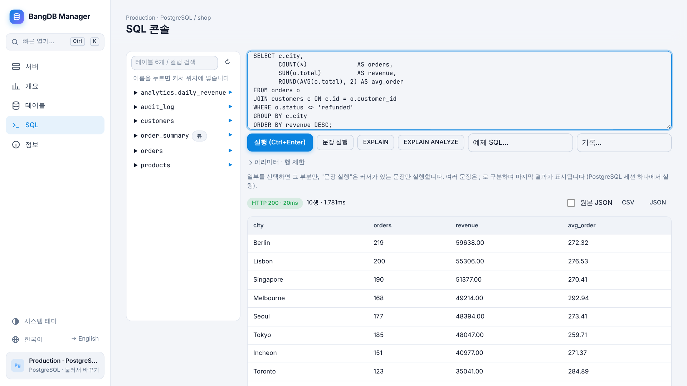 | 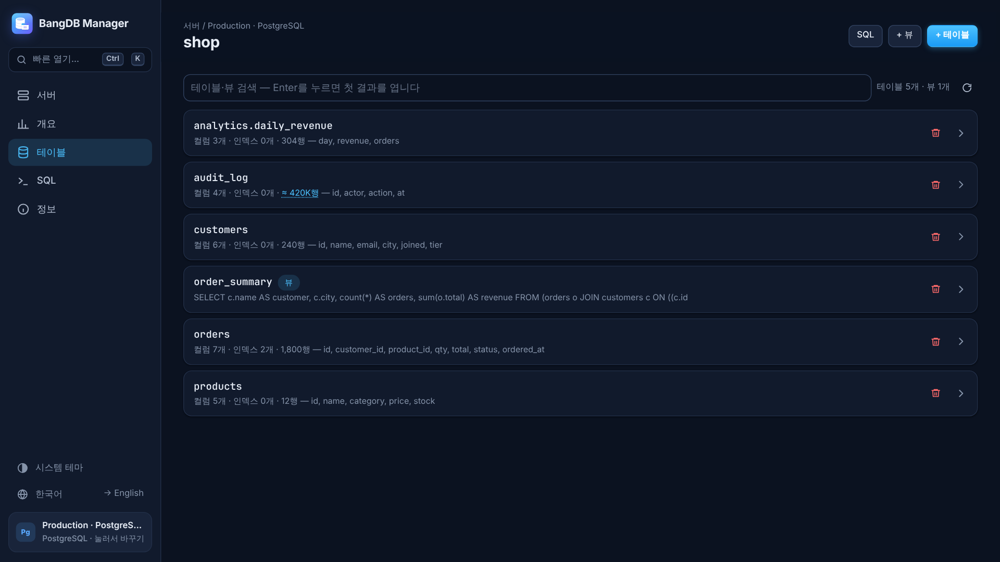 |
| SQL 콘솔 — 스키마 패널, 문장 단위 실행, 결과 정렬 | 테이블 목록 — 행 수(큰 테이블은 ≈ 추정), 뷰 |
| 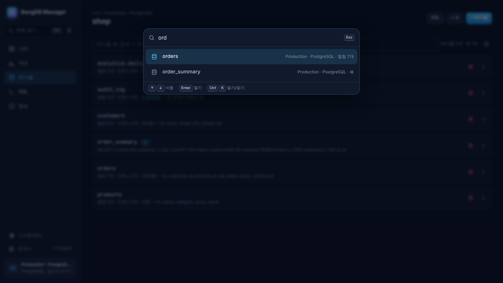 | 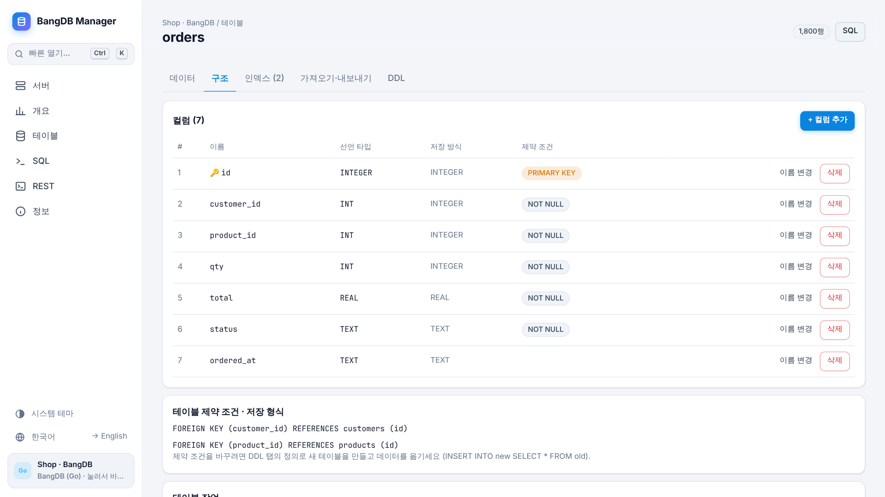 |
| 빠른 열기 (Ctrl/⌘+K) | 구조 편집 — 컬럼·제약 조건 |
| 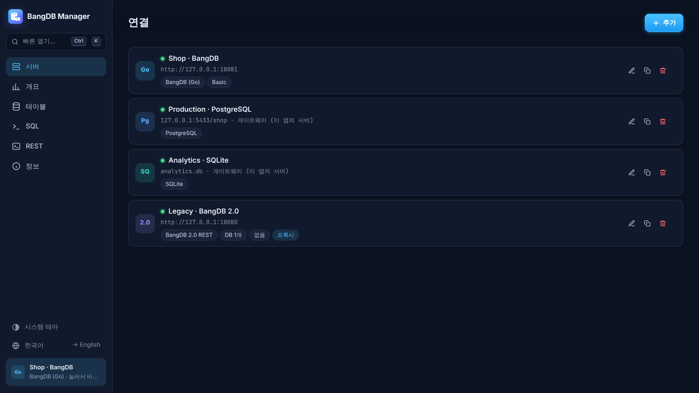 | 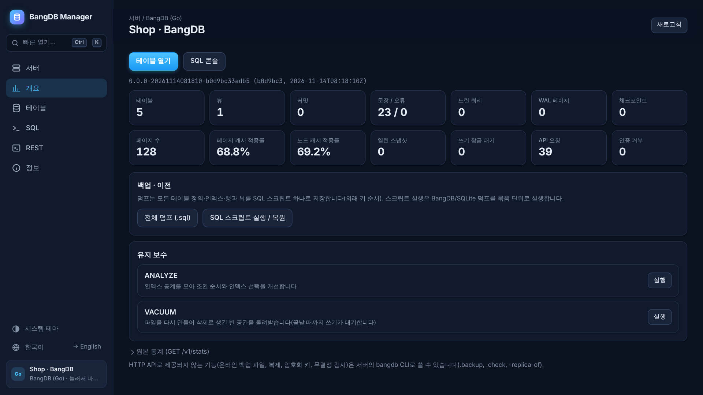 |
| 서버 목록 — 종류별 아이콘, 연결 상태 | BangDB 서버 개요 — 통계, 덤프/복원, 유지 보수 |
| 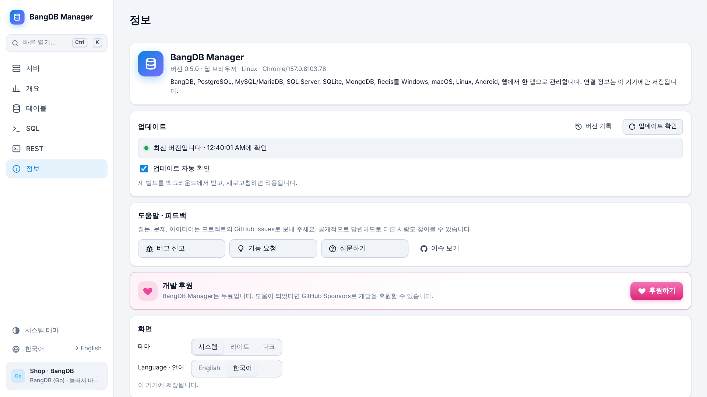 | 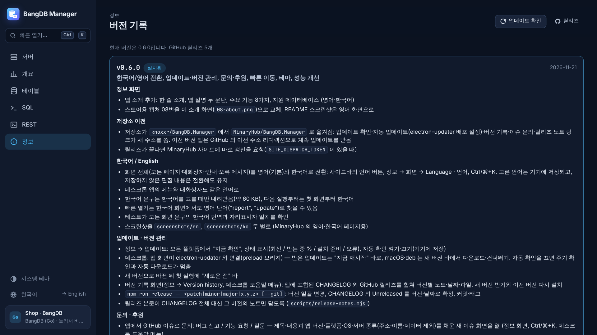 |
| 정보 — 업데이트, 문의, 후원 | 버전 기록 — 릴리즈 노트, 이전 버전 설치 |

<p>
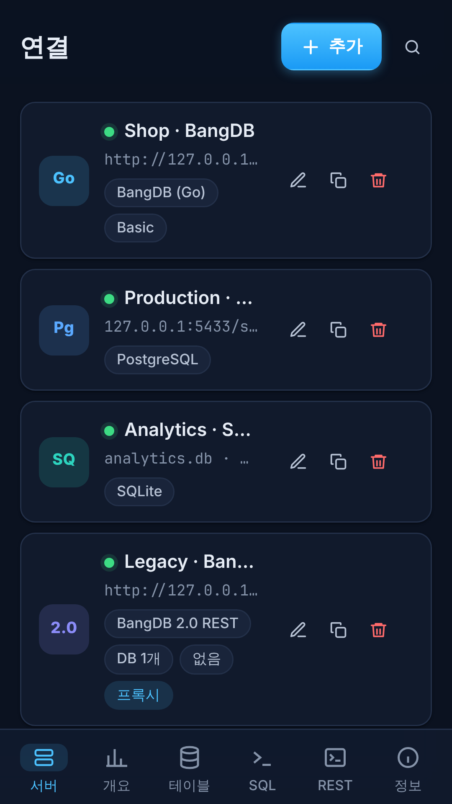
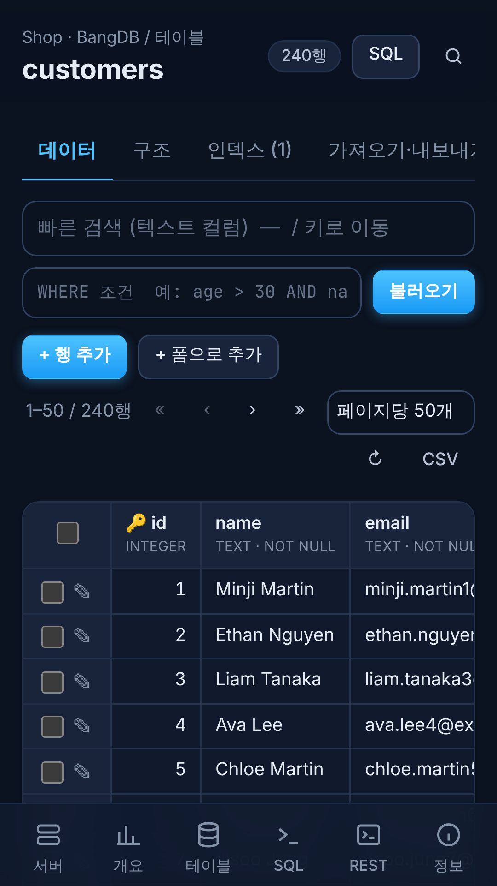
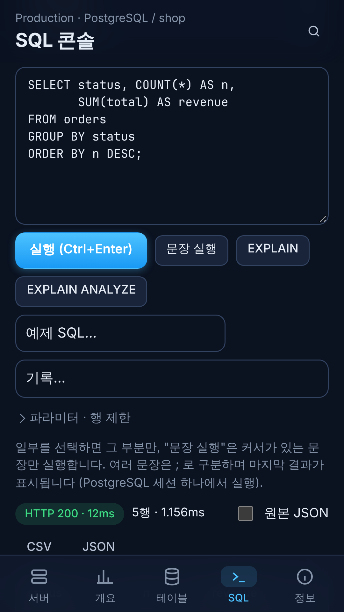
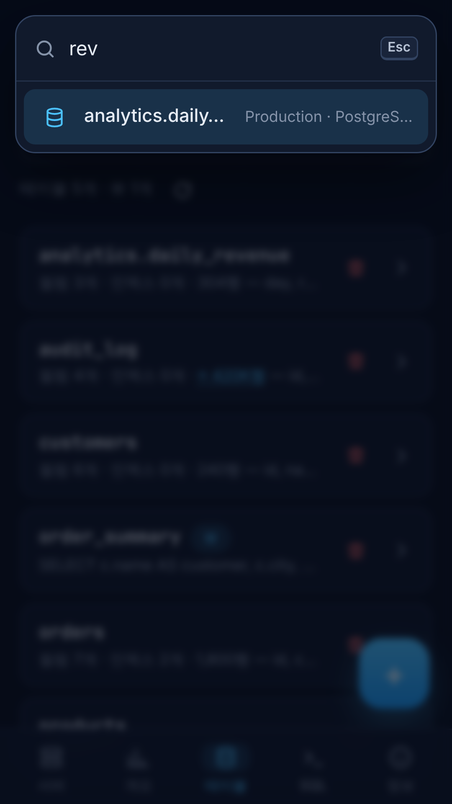
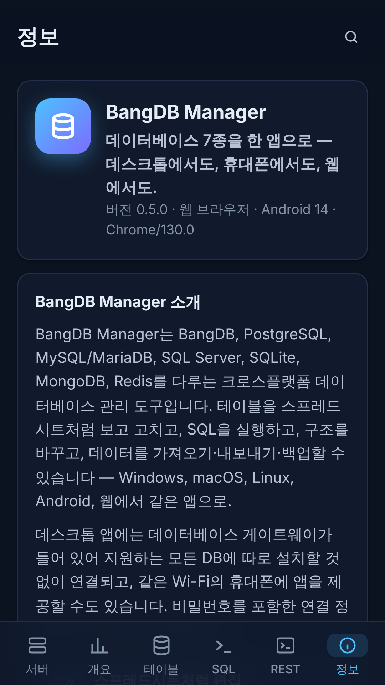
</p>

스토어·앱 소개 사이트 등록용 원본 이미지는 [`screenshots/`](./screenshots) 에 있습니다 — 한국어(`ko/`)·영어(`en/`) 화면 각각 데스크톱 1920×1080, 휴대폰 1080×1920, 그리고 기능 그래픽 1024×500.

## 지원 데이터베이스

| 서버 종류 | 연결 방법 | 기본 포트 |
|---|---|---|
| **BangDB (Go)** — [knoxxr/bangdb](https://github.com/knoxxr/bangdb) | `bangdb -http :18081 -password <pw> app.db` 로 JSON HTTP API 를 켬 (`http-api` 브랜치 이상). `-http-cors` 로 앱 주소를 허용하면 브라우저에서 프록시 없이 직접 연결됩니다. | 18081 |
| **BangDB 2.0 REST** — bangdb.com | 서버의 REST API 를 그대로 사용 | 18080 |
| **PostgreSQL · MySQL/MariaDB · SQL Server · SQLite** | DB 게이트웨이 경유 (아래 참고). 그리드 편집·구조 편집·SQL 콘솔은 BangDB (Go) 와 같은 화면 | 5432 · 3306 · 1433 · 파일 |
| **MongoDB** | DB 게이트웨이 경유. 컬렉션·문서(Extended JSON)·집계·인덱스 전용 화면 | 27017 |
| **Redis** | DB 게이트웨이 경유. 키 브라우저·타입별 편집기·명령 콘솔 | 6379 |

## 업데이트 · 버전

| 환경 | 동작 |
|---|---|
| Windows 설치판, Linux AppImage | 시작 8초 후와 4시간마다 GitHub 릴리즈를 확인해 내려받고, 준비되면 "지금 재시작" 바를 띄웁니다(닫으면 앱을 끌 때 설치). |
| macOS dmg, Linux deb | 서명이 없어 자동 설치가 안 되므로 새 버전 알림과 다운로드 버튼("이 버전 건너뛰기" 가능). |
| 웹 / PWA | 서비스 워커가 한 시간마다, 그리고 앱이 다시 보일 때 새 빌드를 받아 "새로고침" 바를 띄웁니다. |
| Android APK | 하루 한 번 최신 릴리즈를 확인해 다운로드 바를 띄웁니다. |

- **정보 → 업데이트**: 지금 확인, 상태(최신 / 받는 중 % / 설치 준비 / 오류), **자동 확인 켜기·끄기**(기기에 저장). 데스크톱은 도움말 메뉴에서도 확인할 수 있습니다.
- **새 버전으로 바뀐 뒤** 첫 실행에 "새로운 점" 바가 한 번 뜹니다.
- **정보 → 버전 기록**: 앱에 함께 들어 있는 CHANGELOG(오프라인에서도 보임)와 GitHub 릴리즈를 합쳐 버전별 노트·날짜·파일을 보여 주고, 새 버전 받기와 **이전 버전 다시 설치**(되돌리기) 링크를 제공합니다.
- 끄기: 데스크톱은 `BANGDB_MANAGER_NO_UPDATE=1` 로 실행하면 업데이트 기능 전체가 꺼집니다.

## 문의 · 후원

- **버그 신고 · 기능 요청 · 질문** — 앱의 **정보 → 도움말 · 피드백**(또는 Ctrl/⌘+K → "Report a bug")에서 제목과 내용을 쓰면 GitHub 새 이슈 화면이 내용이 채워진 채로 열립니다. 앱 버전·플랫폼·OS·저장된 서버 종류가 함께 들어가며(서버 주소·이름·데이터는 넣지 않음), 미리 보고 끌 수 있습니다. 직접 쓰려면 [Issues](https://github.com/MinaryHub/BangDB.Manager/issues/new/choose).
- **후원** — 도움이 되었다면 [GitHub Sponsors](https://github.com/sponsors/knoxxr) 로 개발을 후원할 수 있습니다 (앱의 정보 화면, 데스크톱 도움말 메뉴, 저장소의 Sponsor 버튼).

## English

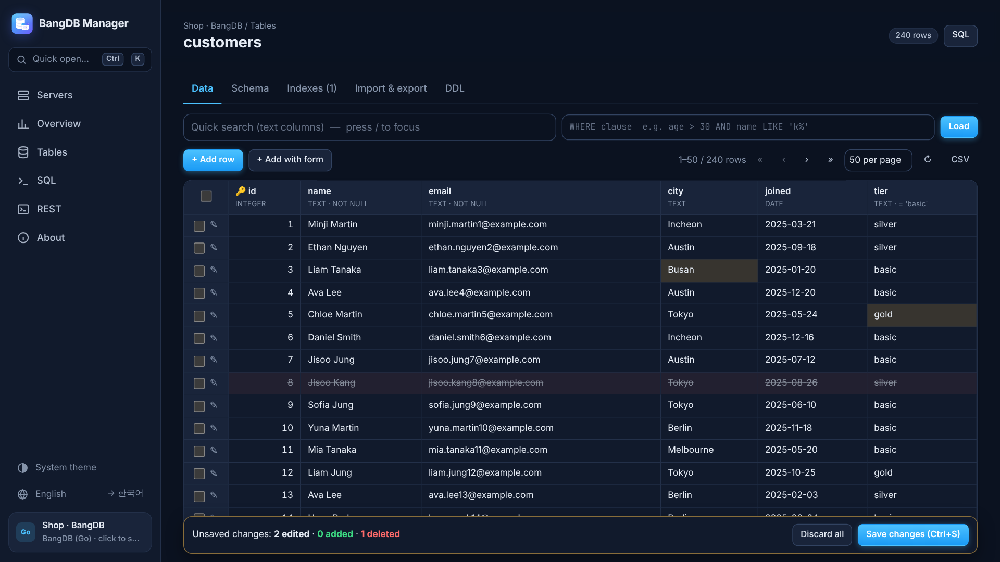

**BangDB Manager** is a free database manager (source on GitHub) for **BangDB, PostgreSQL, MySQL/MariaDB, SQL Server, SQLite, MongoDB and Redis**. One app runs on Windows, macOS, Linux, Android and in the browser (installable PWA).

- Spreadsheet-style table editing with batched, transactional saves; form editor; search, filters, sorting and paging
- SQL console with a schema panel, run-statement-at-cursor, EXPLAIN, parameters, history and CSV/JSON export
- Schema tools: create tables and views, add/alter/rename/drop columns, indexes, DDL, copy and rename tables
- Import CSV/TSV/JSON/JSONL, export CSV/JSON/SQL, full SQL dump and restore (key-based paging for big tables)
- English and Korean UI, switchable at any time; quick open (Ctrl/⌘+K), keyboard shortcuts, dark/light/system themes
- Automatic updates (desktop installs in the background, web reloads, Android notifies), version history with release notes and older-version downloads
- Report bugs, request features and ask questions from the app (GitHub Issues); sponsor development on [GitHub Sponsors](https://github.com/sponsors/knoxxr)
- The desktop app bundles a gateway for PostgreSQL, MySQL, SQL Server, SQLite, MongoDB and Redis, and can serve the app to phones on the same network
- Connection details are stored only on your device

**[Download the latest release](https://github.com/MinaryHub/BangDB.Manager/releases/latest)** · [Report an issue](https://github.com/MinaryHub/BangDB.Manager/issues/new/choose) · [Sponsor](https://github.com/sponsors/knoxxr)

---

# 개발자 문서

> UI 는 영어(기본)와 한국어를 지원합니다. 이 문서는 한국어로 유지합니다.

### UI 문구 번역

화면 문구는 영어 원문을 키로 쓰는 `t()` 로 감싸고(`src/i18n/index.ts`), 한국어는 `src/i18n/ko/*.ts` 에 둡니다. 개수에 따라 달라지는 문구는 `tp(n, '{n} row', '{n} rows')`, 상수에 둔 문구는 `tx()` 로 표시하고 보여 줄 때 `t()` 를 부릅니다. `npm test` 가 소스의 모든 문구에 한국어가 있는지, `{자리표시자}` 가 같은지 확인하므로 새 문구를 넣으면 번역도 함께 넣어야 합니다. 한국어 파일은 한국어를 고를 때만 내려받습니다. 데스크톱 앱의 메뉴·대화상자 문구는 `electron/i18n.mjs` 에 있습니다.

## 빠른 시작 (개발)

```bash
npm install
npm install --prefix proxy                         # DB 게이트웨이 드라이버 (pg, mysql2, mssql, mongodb, redis)
BANGDB_URL=http://192.168.0.10:18080 npm run dev   # http://localhost:5173
```

개발 서버는 `/gw/*` 에서 DB 게이트웨이도 함께 서비스하고, `/bangdb/*` 를 `BANGDB_URL` 로 전달합니다. 연결 추가 시 **"프록시 경유"** 를 켜면 CORS 없이 동작합니다.
같은 Wi-Fi 의 스마트폰에서는 `http://<PC IP>:5173` 으로 접속하면 됩니다.

BangDB 가 없을 때는 모의 서버로 UI를 확인할 수 있습니다.

```bash
node scripts/mock-bangdb.mjs          # 18080 포트에 모의 BangDB
```

## 데스크톱 앱 (Windows / Linux / macOS)

릴리즈 페이지의 설치 파일을 내려받습니다.

| OS | 파일 | 설치 |
|---|---|---|
| Windows 10/11 (x64) | `bangdb-manager-<버전>-windows-x64-setup.exe` | 실행 → 설치 위치 선택. 서명이 없어 SmartScreen 경고가 뜨면 "추가 정보 → 실행" |
| Linux (x64) | `bangdb-manager-<버전>-linux-x86_64.AppImage` | `chmod +x` 후 실행 (설치 불필요) |
| Debian/Ubuntu | `bangdb-manager-<버전>-linux-amd64.deb` | `sudo apt install ./bangdb-manager-*.deb` |
| macOS (Apple Silicon) | `bangdb-manager-<버전>-macos-arm64.dmg` | 서명이 없어 처음엔 우클릭 → 열기 |

데스크톱 앱에는 프록시와 DB 게이트웨이가 내장되어 있습니다. BangDB 2.0 REST 서버는 "프록시 경유"(데스크톱에서 만든 REST 연결은 기본으로 켜짐)로, PostgreSQL·MySQL·SQL Server·SQLite·MongoDB·Redis 는 게이트웨이 주소를 비워 둔 채로 바로 연결됩니다. 게이트웨이 토큰은 앱이 실행마다 만들어 자기 창에 자동으로 넣습니다(`GATEWAY_TOKEN` 환경 변수로 고정 가능). SQLite 파일 폴더는 문서 폴더의 `BangDB Manager`(`SQLITE_ROOT` 로 변경).

메뉴 **서버 → 휴대폰 접속 허용** 을 켜면 앱이 `http://<PC IP>:8080` 에서 같은 UI 를 제공하므로, 같은 Wi-Fi 의 휴대폰은 아무것도 설치하지 않고 브라우저로 접속해 "홈 화면에 추가"하면 됩니다(방화벽에서 8080 허용 필요, 포트는 `BANGDB_MANAGER_LAN_PORT`). 휴대폰에서 게이트웨이 DB 를 쓰려면 **서버 → 휴대폰 접속 주소·토큰 보기** 의 토큰을 연결 편집의 게이트웨이 토큰에 넣습니다.

소스에서 만들려면: `npm run build && npm ci --omit=dev --prefix proxy && npm run desktop:linux` (또는 `desktop:win`, `desktop:mac`, 각 OS 에서 실행). 결과는 `release/` 에 생깁니다. 개발 중 실행은 `npm run build && npm run electron`.

## 배포 (웹/PWA)

```bash
npm run build                                   # dist/
npm install --prefix proxy --omit=dev
GATEWAY_TOKEN=secret BANGDB_URL=http://192.168.0.10:18080 npm run proxy   # http://0.0.0.0:8080 에서 dist + /bangdb 프록시 + /gw 게이트웨이
```

또는 Docker (SQLite 파일은 `/data` 볼륨):

```bash
docker build -t bangdb-manager .
docker run -p 8080:8080 -e GATEWAY_TOKEN=secret -e BANGDB_URL=http://192.168.0.10:18080 -v "$PWD/data:/data" bangdb-manager
```

`dist/` 는 순수 정적 파일이므로 아무 정적 호스팅에 올려도 되지만, 그 경우 BangDB 서버가 CORS 헤더를 보내지 않으면 브라우저에서 직접 호출이 막힙니다. 이때는 프록시를 함께 쓰거나 네이티브 앱을 사용하세요.
PWA 설치(홈 화면 추가)는 HTTPS 또는 localhost 에서만 가능합니다.

## Android / iOS 네이티브 앱

네이티브 셸에서는 `CapacitorHttp` 로 직접 호출하므로 CORS 제약이 없고 사내망의 `http://` 서버에도 연결됩니다.

```bash
npm run build
npm run cap:android     # android/ 생성 후 Android Studio 로 열기: npx cap open android
npm run cap:ios         # ios/ 생성 후 Xcode 로 열기 (macOS): npx cap open ios
```

이후 UI 를 수정했으면 `npm run build && npx cap sync` 로 반영합니다.
앱 ID는 `capacitor.config.ts` 의 `appId` 에서 바꿀 수 있습니다.

## BangDB (Go) 연결

knoxxr/bangdb 의 `httpapi` 패키지가 제공하는 엔드포인트를 사용합니다: `GET /v1/health`, `GET /v1/tables`, `GET /v1/tables/{name}`, `POST /v1/query`, `GET /v1/stats`. 모든 작업은 SQL 로 수행되며(`src/api/goapi.ts`), 행 수정·삭제는 모든 테이블에 있는 숨은 `rowid` 로 행을 찾습니다(기본 키가 없어도 편집 가능).

```bash
# 브라우저에서 직접 연결하려면 앱 주소를 -http-cors 로 허용합니다 ('*' = 모두). 스마트폰에서 접속하려면 0.0.0.0 으로 바인딩
bangdb -http 0.0.0.0:18081 -http-cors '*' -password s3cret app.db
```

`-http-cors` 없이 웹 브라우저에서 연결하면 CORS 오류("Failed to fetch")가 납니다. 데스크톱 앱과 Android 앱은 CORS 제약이 없어 필요 없습니다.

## 다른 데이터베이스 (DB 게이트웨이)

브라우저와 휴대폰은 PostgreSQL·MySQL 같은 DB 의 전용 프로토콜로 직접 접속할 수 없어서, DB 에 닿는 PC 에서 도는 **게이트웨이**(`proxy/gateway/`)를 거칩니다. `npm run dev` 와 `proxy/server.mjs`(Docker 포함)가 같은 주소의 `/gw/*` 로 게이트웨이를 서비스합니다.

- 연결 추가 → 서버 종류에서 DB 를 고르고 호스트·포트·계정(또는 연결 문자열)을 입력합니다. 게이트웨이 주소를 비우면 이 앱을 띄운 서버를 씁니다. **휴대폰 앱(Capacitor)은 게이트웨이 주소를 꼭 입력**해야 합니다.
- 모든 요청은 `POST /gw/<작업>` 에 `{ conn: {kind, host, port, user, password, database, …}, … }` 를 보내는 형태이고, 게이트웨이는 연결 설정별로 풀을 만들어 10분간 재사용합니다.
- 관계형 DB 는 BangDB (Go) HTTP API 와 같은 응답 형태(`tables`, `query`, `batch`)로 바꿔 주므로 그리드·구조 편집·덤프 화면을 그대로 씁니다. 방언 차이(따옴표, 페이지, 자동 증가, ALTER, EXPLAIN, 유지 보수 명령, 리터럴)는 `src/api/dialect.ts` 에 있습니다.
- 행 편집은 기본 키로 행을 찾습니다. 기본 키가 없으면 SQLite 는 `rowid`, PostgreSQL 은 `ctid` 를 쓰고, MySQL·SQL Server 는 읽기 전용이 됩니다.

| 환경 변수 | 뜻 |
|---|---|
| `GATEWAY_TOKEN` | 요청의 `x-gateway-token` 헤더가 이 값과 같아야 합니다 (연결 편집 → 게이트웨이 토큰). **설정하지 않으면 게이트웨이는 닫혀 있고**, 이 PC 에서 같은 주소로 연 앱(예: `http://localhost:5173`)의 요청만 받습니다. 휴대폰·다른 PC·Docker 에서 쓰려면 꼭 설정하세요. |
| `GATEWAY_ALLOWED_HOSTS` | 쉼표로 구분한 DB 호스트 목록. 설정하면 그 밖의 호스트로는 접속하지 않고, 연결 문자열(URI)은 받지 않습니다(호스트·포트 칸만) (예: `db1.local,10.0.0.5`). |
| `SQLITE_ROOT` | 게이트웨이가 여는 SQLite 파일의 폴더 (기본: 실행 폴더의 `data/`, Docker: `/data`). 이름이 `.db`·`.sqlite`·`.sqlite3`·`.db3` 인 파일만 열고, 심볼릭 링크를 풀어 그 밖을 가리키는 경로는 거부하고, `ATTACH`·`DETACH`·`VACUUM INTO` 도 막습니다. |
| `GATEWAY_MAX_BODY` | 요청 본문 최대 크기 (기본 32 MiB) |

TLS 는 기본으로 인증서를 검증합니다. 자체 서명 인증서는 연결 편집에서 "인증서 검증 안 함"을 켜야 합니다. 비밀번호를 포함한 연결 정보는 기기의 브라우저 저장소에만 저장되고, 게이트웨이는 요청마다 받아 메모리의 연결 풀에만 둡니다.

## BangDB 2.0 REST 엔드포인트와 검증 상태

`src/api/endpoints.ts` 에 모든 템플릿이 있습니다. BangDB 공식 문서로 확인된 항목은 `verified: true` 입니다.

| 키 | 메서드 | 경로 | 확인 |
|----|--------|------|------|
| listTables | GET | `/db/{db}/list` | ✔ |
| createTable | POST | `/db/{db}/table` | ✔ |
| rowCount | GET | `/db/{db}/{table}/count` | ✔ |
| addIndex | POST | `/db/{db}/{table}/index` | ✔ |
| putDoc | POST | `/db/{db}/{table}/doc` | ✔ |
| query | POST | `/db/{db}/query` (`{"sql": ...}`) | ✔ |
| dropTable | DELETE | `/db/{db}/{table}` | 추정 |
| getDoc / delDoc | GET / DELETE | `/db/{db}/{table}/doc/{key}` | 추정 |
| dropIndex | DELETE | `/db/{db}/{table}/index/{index}` | 추정 |
| tableInfo | GET | `/db/{db}/{table}/info` | 추정 |
| scanDocs | POST | `/db/{db}/{table}/scan` | 추정 |
| createDb / dropDb | PUT / DELETE | `/db/{db}` | 추정 |
| login | POST | `/login` | 추정 |
| serverStats | GET | `/stats` | 추정 |

"추정" 항목이 사용 중인 BangDB 버전과 다르면 **서버 연결 편집 → 고급: REST 엔드포인트 템플릿 재정의** 에서 연결별로 메서드/경로를 바꿀 수 있고, REST 콘솔로 실제 응답을 확인할 수 있습니다.
BangDB 서버는 보통 `bangdb.config` 의 `BANGDB_DATABASE_NAME` 하나를 서비스하므로, DB 목록은 앱에 등록된 이름 목록이며 "기존 DB 등록"으로 추가합니다.

## 버전 관리 · 릴리즈

버전은 `package.json`·`package-lock.json`·`proxy/package.json` 에 같은 값으로 두고, 앱 정보 화면·버전 기록·업데이트 비교에 씁니다.

```bash
npm run release -- minor          # patch | minor | major | 1.4.0
npm run release -- minor --git    # 커밋 "Release v<버전>" 과 태그 v<버전> 까지
git push && git push origin v0.6.0
```

`npm run release` 는 버전을 올리고, CHANGELOG.md 맨 위의 `## Unreleased — 제목` 을 `## v<버전> — 제목 (날짜)` 로 바꿉니다. 새 기능은 개발하면서 그 `Unreleased` 절에 적어 두세요(앱의 버전 기록에도 그대로 보입니다).

`v*` 태그를 푸시하면 `.github/workflows/release.yml` 이 웹 빌드 zip, Android 디버그 APK, Windows 설치 파일, Linux AppImage/deb, macOS dmg 를 만들어 GitHub Release 에 첨부하고, 릴리즈 본문은 `scripts/release-notes.mjs` 가 CHANGELOG 에서 그 버전의 절만 뽑아 만듭니다(`npm run release:notes -- v0.6.0` 으로 미리 보기). `latest*.yml` 과 블록맵도 함께 올라가므로 설치된 앱이 자동으로 따라옵니다.

로컬 `npm run build` 는 `prebuild` 로 patch 버전을 하나씩 올립니다(개발 빌드 구분용). CI(`CI` 환경 변수)와 Docker 빌드는 커밋된 버전을 그대로 쓰고, 건너뛰려면 `NO_VERSION_BUMP=1 npm run build`.

## 테스트

```bash
npm test            # vitest: API·SQL 방언·키셋 페이지(SQLite)·변경 기록 파싱·피드백 URL·업데이트 비교·게이트웨이
node e2e/smoke.mjs ./shots   # Playwright 스모크 (모의 서버 + 프록시 실행 후, 스마트폰 뷰포트)
```

스토어용 스크린샷 다시 만들기는 [`screenshots/README.md`](./screenshots/README.md) 를 보세요.

## 구조

```
src/api/        endpoints.ts(템플릿) · http.ts(fetch/CapacitorHttp 래퍼) · bangdb.ts(종류별 분기) · goapi.ts(SQL 접근: BangDB Go + 게이트웨이)
                dialect.ts(SQL 방언) · gateway.ts · mongo.ts · changelog.ts(버전 기록) · limit.ts
src/store/      연결 목록·요청 기록 (localStorage)
src/pages/      서버 / DB / 테이블 / 테이블 상세 / SQL / REST 콘솔 / 정보 / 버전 기록, MongoDB·Redis 화면
src/components/ 레이아웃(하단 탭·사이드바), 빠른 열기, 모달, 토스트, 데이터 그리드, 행 폼, 스키마 폼, 업데이트 바, 피드백
src/update.ts   업데이트 (PWA 서비스 워커 / Android 릴리즈 확인 / 데스크톱 electron-updater 연결)
src/feedback.ts GitHub 이슈 작성 URL · 진단 정보
proxy/          정적 파일 + CORS 프록시 + DB 게이트웨이 (lib.mjs 는 데스크톱 앱과 공유)
electron/       데스크톱 셸 (내장 프록시·게이트웨이, 휴대폰 접속 LAN 서버, updater.mjs, preload.cjs)
scripts/        release · release-notes · bump-version · 모의 BangDB 서버 · 스토어 스크린샷
.github/        CI·릴리즈 워크플로, 이슈 양식(버그·기능·질문), FUNDING.yml(GitHub Sponsors)
screenshots/    스토어·앱 소개용 이미지
```

## 링크

[Releases](https://github.com/MinaryHub/BangDB.Manager/releases) · [Issues](https://github.com/MinaryHub/BangDB.Manager/issues) · [Sponsor](https://github.com/sponsors/knoxxr) · [CHANGELOG](./CHANGELOG.md)
